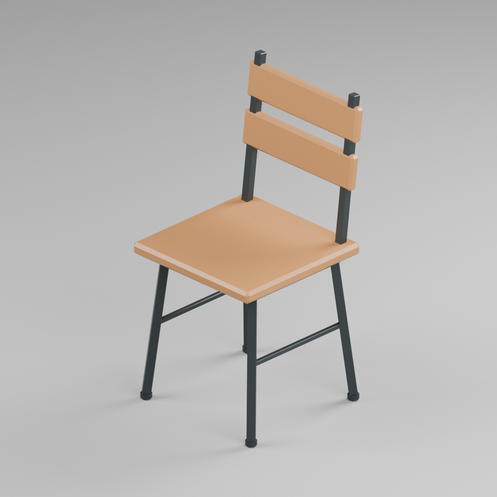
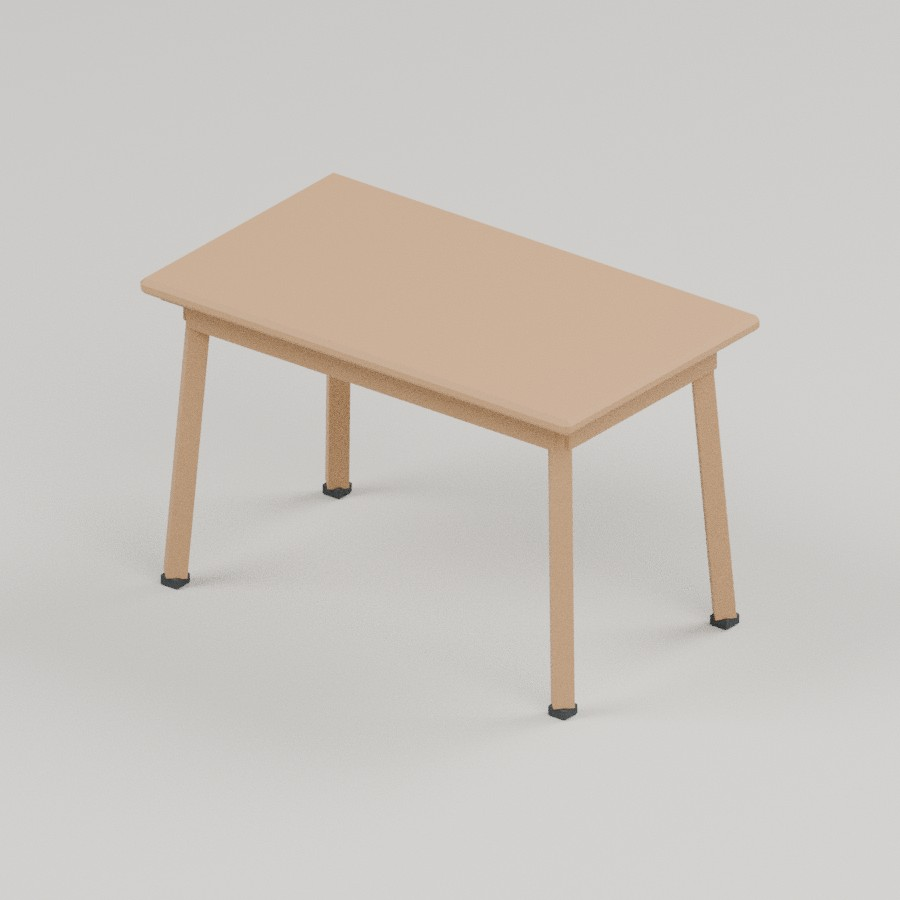
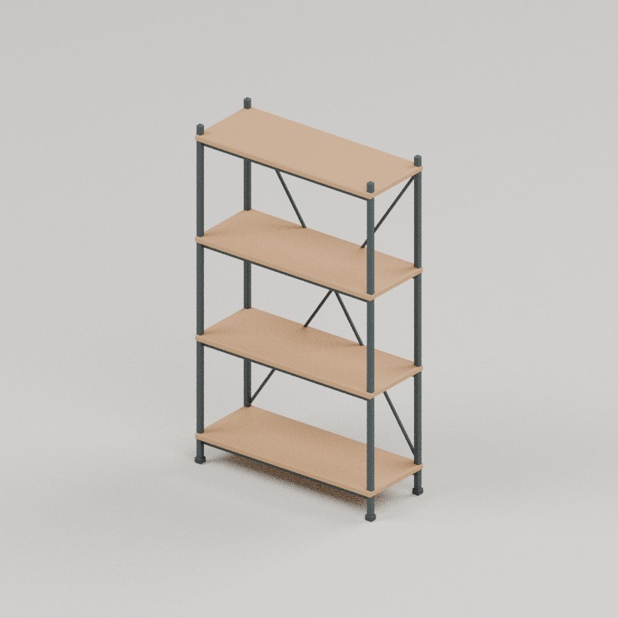
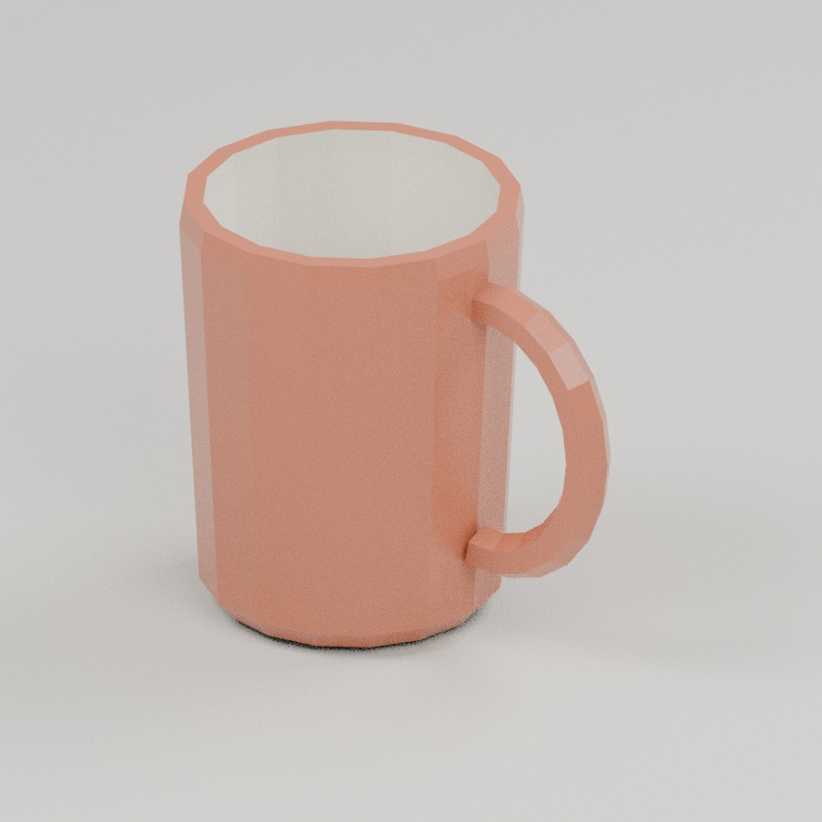
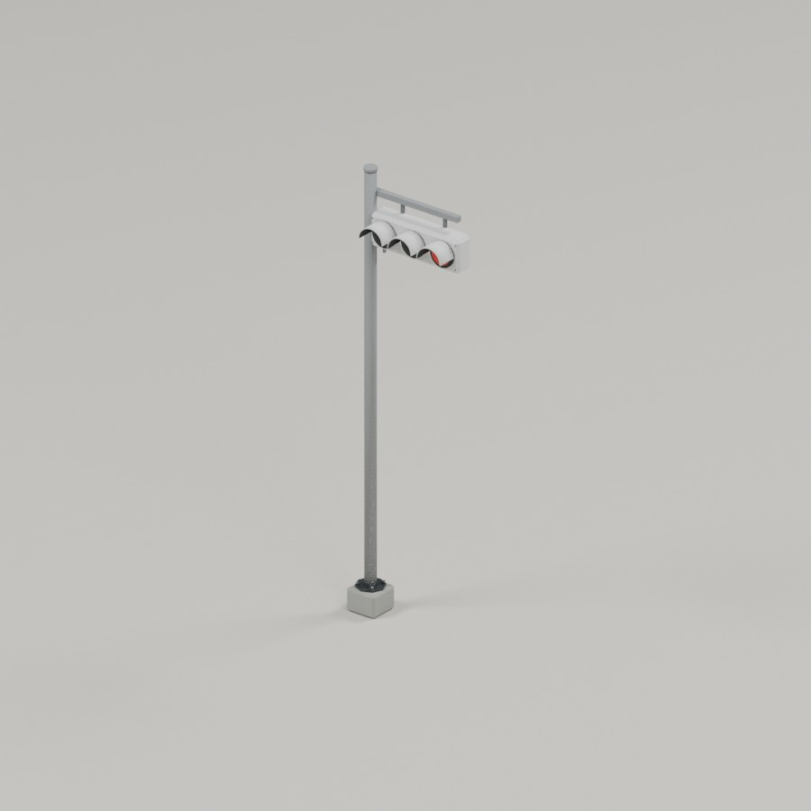
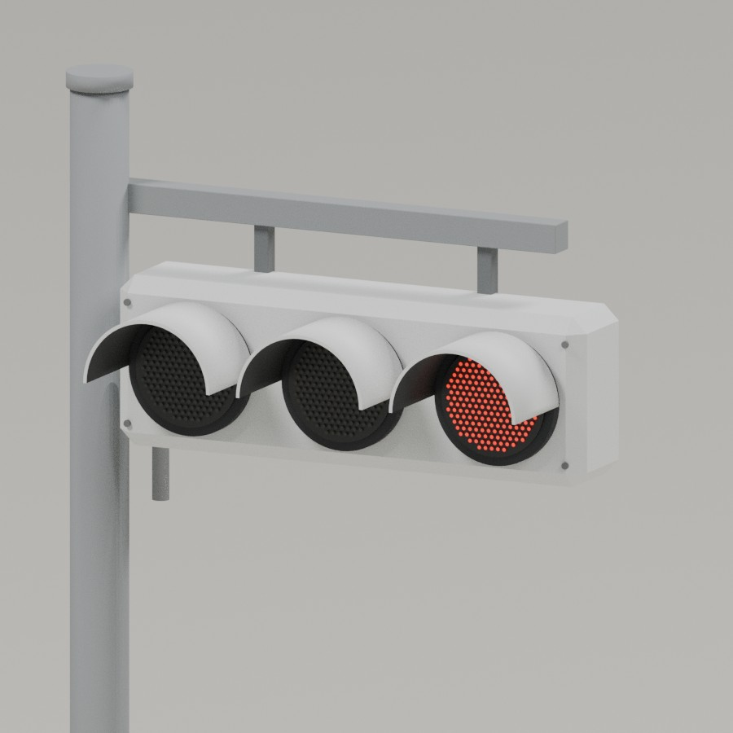
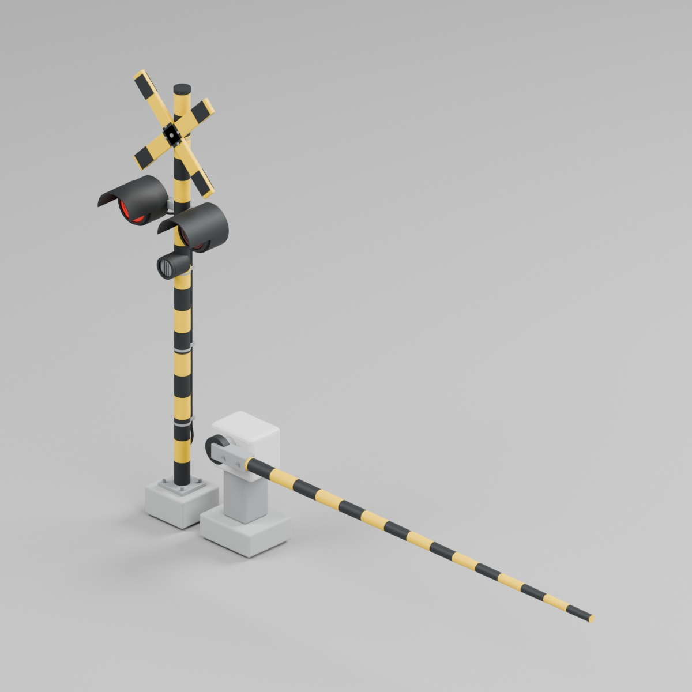
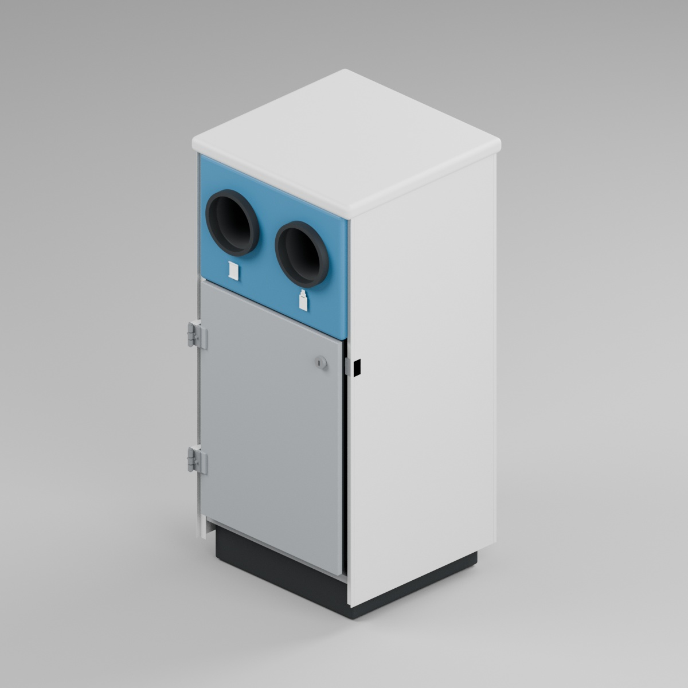

# Low-poly diorama models

現実世界のジオラマに配置するための、形状の自然さと素材の違いを保った、軽量なオリジナル小物集です。現在20モデル。目標は合計1,000モデルです。

## 制作基準

丸い物は自然に丸く見えるよう、曲面に必要な面数を配分します。陶器の釉薬、木材、塗装面、金属、ゴムの反射特性を分けています。日本にある物は、日本で見られる配色・形状・仕様を参考にします。

[詳しい制作基準](docs/asset-standard.md) · [GLB内の材質検証](material-validation.json)

## 共通仕様

- GLB、編集用 `.blend`、正面寄り／背面寄りの確認画像を各モデルに同梱。
- メートルスケール。BlenderはZ-up、正面は-Y。GLBは標準のY-upに変換して書き出しています。
- 原点は床面付近。信号機は支柱の基部、他は設置面の中央付近です。
- 実在の特定製品の複製ではありません。寸法はジオラマ向けに設定した目安で、製造・施工用の図面ではありません。
- 外部テクスチャ・外部モデルは使用せず、マテリアルを同梱。外部ファイル参照なしでGLBを開けます。
- すべてのファイルは100,000,000バイト未満。上限に近づけず小さく保っています。
- ポリゴン数は三角形換算で記載しています。

## 一覧

| モデル | 三角形 | GLB | 編集用Blend | 寸法 X × Y × Z（m、Blender座標） |
|---|---:|---:|---:|---|
| [ダイニングチェア](assets/furniture/dining_chair) | 640 | 57.6 KB | 100.1 KB | 0.43 × 0.45073 × 0.88121 |
| [木製テーブル](assets/furniture/oak_table) | 616 | 56.3 KB | 99.2 KB | 1.2 × 0.7 × 0.75 |
| [オープンシェルフ](assets/furniture/open_shelf) | 2,088 | 145.5 KB | 107.1 KB | 0.905 × 0.3715 × 1.51 |
| [マグカップ](assets/household/mug) | 1,684 | 40.1 KB | 110.3 KB | 0.123 × 0.086 × 0.108 |
| [横型信号機](assets/street/traffic_signal) | 10,522 | 379.9 KB | 190.1 KB | 1.4150 × 0.5896 × 4.9505 |
| [踏切警報機・遮断機（下降）](assets/street/railway_crossing_lowered) | 42,452 | 1494.4 KB | 325.6 KB | 5.2810 × 0.7150 × 3.7888 |
| [公共用分別回収ボックス](assets/street/public_recycling_bin) | 22,240 | 1127.4 KB | 216.6 KB | 0.4800 × 0.4890 × 1.0175 |

## プレビューとファイル

### ダイニングチェア



[GLB](assets/furniture/dining_chair/dining_chair.glb) · [Blend](assets/furniture/dining_chair/dining_chair.blend) · [背面画像](assets/furniture/dining_chair/back.jpg) · [メタデータ](assets/furniture/dining_chair/metadata.json)

### 木製テーブル



[GLB](assets/furniture/oak_table/oak_table.glb) · [Blend](assets/furniture/oak_table/oak_table.blend) · [背面画像](assets/furniture/oak_table/back.jpg) · [メタデータ](assets/furniture/oak_table/metadata.json)

### オープンシェルフ



[GLB](assets/furniture/open_shelf/open_shelf.glb) · [Blend](assets/furniture/open_shelf/open_shelf.blend) · [背面画像](assets/furniture/open_shelf/back.jpg) · [メタデータ](assets/furniture/open_shelf/metadata.json)

### マグカップ



[GLB](assets/household/mug/mug.glb) · [Blend](assets/household/mug/mug.blend) · [背面画像](assets/household/mug/back.jpg) · [メタデータ](assets/household/mug/metadata.json)

### 横型信号機



[GLB](assets/street/traffic_signal/traffic_signal.glb) · [Blend](assets/street/traffic_signal/traffic_signal.blend) · [背面画像](assets/street/traffic_signal/back.jpg) · [メタデータ](assets/street/traffic_signal/metadata.json)

### 信号機の背面接続部



上の写真は修正した背面接続部です。モデル全体では、明るさを抑えたライトグレーの塗装筐体・高粗さの金属支柱・暗い光学ベース・個別のLED配列・黒い保持リングを分けています。支柱はクロームのような強い鏡面反射を抑え、ライトは赤点灯／青・黄消灯を区別しています。フード付きの汎用モデルで、特定製品の複製ではありません。国内灯器の白い外装・LED配列の参考：[日本信号の製品写真](https://sales.signal.co.jp/traffic_signal/)。寸法・材質の参考：[日本通信電材の製品資料](https://www.nippon-tsushin.jp/wp/wp-content/themes/nippontsushin/file/business/electric/singou.pdf)。資料の製品はフードレスで、本モデルとは構造が異なります。

## 独立レビュー済みの追加モデル

次の2点は、形状・接続部・素材・別方向の照明・保存ファイル・生成コードを独立レビュー済みです。既存5点を、この新基準で一括承認したという意味ではありません。

### 踏切警報機・遮断機（下降）



[GLB](assets/street/railway_crossing_lowered/railway_crossing_lowered.glb) · [Blend](assets/street/railway_crossing_lowered/railway_crossing_lowered.blend) · [背面](assets/street/railway_crossing_lowered/back.jpg) · [接写](assets/street/railway_crossing_lowered/close_up.jpg)

### 公共用分別回収ボックス



[GLB](assets/street/public_recycling_bin/public_recycling_bin.glb) · [Blend](assets/street/public_recycling_bin/public_recycling_bin.blend) · [背面](assets/street/public_recycling_bin/back.jpg) · [接写](assets/street/public_recycling_bin/close_up.jpg)

[昼光での配置確認](generators/batch02b/previews/context_daylight.jpg) · [別方向の照明](generators/batch02b/previews/context_alternate_light.jpg) · [再生成方法・制約](generators/batch02b/README.md)

踏切は遮断棒を下げた片側ユニット、回収ボックスは屋根のある公共空間向けの静的モデルです。文脈画像は縮尺と材質を確認するための配置で、完成した写真風ジオラマではありません。

## 検証

Blender 4.3.2で制作。保存した全 `.blend` を再度開き、各GLBを空のシーンへ読み込み直しました。三角形数と外接範囲の一致、頂点の数値異常、面積ゼロの三角形、ファイル容量を検証しています。初期5点の結果は [validation.json](validation.json)、追加2点の結果は [batch02bの検証結果](generators/batch02b/validation.json) を参照してください。

- GLBには照明・背景床・カメラを含みません。
- Blendの `PREVIEW STUDIO` コレクションは通常のビューポートでは非表示です。モデルを別シーンへ移す際は `ASSET` コレクションを使ってください。
- パーツ同士の接触・重なりを許すジオラマ／描画用モデルです。水密の一体形状や3Dプリント適性は保証していません。
- 信号機はライトグレー筐体・艶を抑えた亜鉛めっき調支柱の横型汎用デザインです。赤LEDを点灯、青・黄は消灯した状態にしています。動的な点灯制御やアニメーションは含みません。
- マグカップは内部の空洞と底・壁の厚みを持たせています。

## 再生成

Blender 4.3.2 と、プレビュー変換用の Python / Pillow を使用します。以下は初期5点用の手順です。追加2点は [batch02bの再生成手順](generators/batch02b/README.md) を使用してください。

```sh
blender -b --python scripts/build_assets.py
ONLY_ASSETS=oak_table,dining_chair,open_shelf,mug,traffic_signal blender -b --python scripts/validate_assets.py
blender -b --python scripts/render_signal_detail.py
python scripts/prepare_previews.py
python scripts/inspect_materials.py
python scripts/update_catalog_readme.py
```

再生成は既存のモデルファイルを書き換えます。手作業で編集したモデルは別名で保存してください。

## ライセンス

配布ライセンスは未設定です。公開リポジトリであることだけを、無制限の再利用許可とは扱わないでください。


### 信号機の配色再調整

筐体・ひさしと支柱の明度差を抑えました。形状と赤点灯状態は変更していません。保存したBLENDの再読込とGLBの再インポート、別照明での比較を独立レビューで確認済みです。色は写真からの推定で、測色値や特定製品の保証色ではありません。確認画像の支柱には若干のレンダーノイズがあります。参考：[大阪府警の信号機資料](https://www.police.pref.osaka.lg.jp/kotsu/kisei/shingouki/12111.html)。

## 追加モデル：街灯・ベンチ・コーン

以下の3点は制作担当とは独立したレビュー、保存ファイルの再読込、実配置・別照明の確認を経て公開しています。

- [公園ベンチ](assets/street/park_bench)：5,800三角形、GLB 458,368 bytes
- [街路灯](assets/street/streetlight)：8,428三角形、GLB 269,884 bytes
- [三角コーン](assets/street/traffic_cone)：12,288三角形、GLB 495,528 bytes（[現行検証](generators/cone_function_revision/README.md)）

街灯は消灯状態です。コーンは底面が開いた中空・積み重ね可能モデルに修正済みです。白帯は通常のPBR材質による表現です。専用の再帰反射シェーダーは使用していません。

[生成・検証手順](generators/batch02a/README.md) · [検証結果](generators/batch02a/validation.json)

## 追加モデル：やかん・茶碗・まな板

保存ファイルの再読込、注ぎ口の開口、木口・底面、2種類の照明下での実配置と生成手順を独立レビューで確認しています。

- [陶器の茶碗](assets/household/ceramic_rice_bowl)：5,564三角形、GLB 121,412 bytes
- [ステンレス製やかん](assets/household/stainless_kitchen_kettle)：19,980三角形、GLB 527,668 bytes
- [木製まな板](assets/household/wooden_cutting_board)：300三角形、GLB 1,267,908 bytes

汎用的な清潔な小物です。木目は近似表現で、接写向けの細かな摩耗は含みません。確認画像には若干のサンプリングノイズがあります。

[生成・検証手順](generators/batch03a/README.md) · [検証結果](generators/batch03a/validation.json)

## 三角コーンの構造修正

メーカーの底面写真・積み重ね構造を調査し、底を塞いでいた旧モデルを修正しました。連続した中空の殻と開いた底面を持ち、3個の積み重ねで接触支持と干渉のない隙間を独立検証しています。寸法・肉厚・積み重ね間隔の一部は設計上の推定で、変形・摩擦・荷重は物理シミュレーションしていません。

[底面](assets/street/traffic_cone/underside.jpg) · [現行の生成・検証手順](generators/cone_function_revision/README.md)

コーンの再生成には上記の修正版を使用してください。generators/batch02a 内のコーン生成手順・カタログ・検証画像は旧版の履歴であり、現在のコーンを上書きする用途には使用しないでください。現在の成果物情報はルートcatalog.jsonを参照してください。

## やかんの機構修正

メーカーの製品写真・注ぎ動作の写真と照合し、取っ手を注ぎ口と同じ前後方向のアーチに変更しました。横倒し用の同軸ヒンジと蓋の差し込み部も修正しています。左右への折り倒し、蓋を外す初動から全行程、把持と蓋を押さえる空間を、保存モデルで独立検証しました。蓋はロック式ではなく、注ぐときに保持する前提です。流体・耐熱・強度の安全試験ではありません。

[現行やかんの生成・検証手順](generators/kettle_function_revision/README.md)

やかんの再生成には修正版を使用してください。generators/batch03aのやかん生成手順・検証・画像は旧版履歴であり、現行やかんを上書きする用途には使用しないでください。茶碗とまな板は変更していません。

## 棚とマグの接合部修正

実物の組立資料・メーカー写真に照らして、棚の背面補強材を棚板の外へ移し、支柱の取り付け金具と交差部の隙間を設けました。マグの下側の取っ手接合部も修正し、内側の空洞と指の空間を保っています。保存GLB/Blend、各接合部と配置、生成手順を独立レビューで確認しました。耐荷重などの安全認証ではありません。

[修正内容・現行生成手順](generators/original_function_revision/docs/repair-notes.md) · [棚の比較](generators/original_function_revision/previews/open_shelf_before_after.jpg) · [マグの比較](generators/original_function_revision/previews/mug_before_after.jpg)

棚とマグを再生成する場合は上記の名前付き修正版フォルダでONLY_ASSETS=open_shelf,mugを指定してください。ルートscriptsの初版手順は棚・マグの現行版を再現しないため、現行ファイルの上書きに使用しないでください。

## 信号機・踏切の接続部修正

信号機の背面ケーブル・サービスパネル、踏切の支柱根元と交差板の取り付けを、実物資料をもとに接続し直しました。信号機の配色・点灯状態は維持しています。遮断機の配置も調整し、保存モデルで可動部を含む0〜90度の干渉確認を行いました。静的な下降姿勢のモデルであり、電気的動作や構造強度の認証ではありません。

[現行の修正内容・生成手順](generators/street_attachment_revision/docs/attachment-revision.md)

信号機・踏切の再生成はこの修正版を使用してください。ルートscriptsおよびgenerators/batch02b内の該当モデルの手順・検証画像は旧版履歴です。現行モデルを上書きする用途には使用しないでください。

## 分別回収ボックスの支持・回収動作修正

筐体と台座、内部容器と底板の支持接触を修正しました。実物のサービス手順・容器寸法を参考に内部容器と扉の構造を見直し、ラッチと扉を開け、容器を少し持ち上げて引き出す全経路を保存モデルで独立確認しています。内部容器は手で支える前提で、閉じた静的モデルを納品しています。実物の容量・耐候性・構造安全性の認証ではありません。

[現行の生成手順・サービス確認](generators/bin_function_revision/README.md) · [底面](assets/street/public_recycling_bin/underside.jpg)

generators/batch02bにある旧回収ボックスの生成・検証内容は履歴です。現在の回収ボックスの再生成には修正版を使用してください。

## 追加モデル：マンホール・縁石・車止め

実物の公式資料に照らし、マンホールの工具の掛かりと引き上げ、蓋の支持・補強リブの隙間、車止めの取付穴と連続したアンカーを保存モデルで独立確認しています。縁石の設置文脈は簡略化され、現場の排水設計や完全な施工図ではありません。

- [鋳鉄製マンホール](assets/street/cast_iron_manhole)：30,256三角形、GLB 4,370,320 bytes
- [コンクリート縁石](assets/street/concrete_curb_straight)：188三角形、GLB 958,648 bytes
- [鋼製車止め](assets/street/steel_roadside_bollard)：11,524三角形、GLB 2,578,260 bytes

汎用的な道路小物です。寸法は参考値で、施工図や認定製品の複製ではありません。確認画像には若干のサンプリングノイズがあります。

[生成・検証手順](generators/pavement_function_revision/README.md) · [検証結果](generators/pavement_function_revision/validation.json)

## 追加モデル：梱包箱・ホチキス・クリップボード

実物の梱包方法やメーカー資料に照らし、箱の上下フラップとテープ、ホチキスの押下位置、クリップと紙の接触・開く空間を独立レビューで確認しています。

- [A4クリップボード](assets/household/a4_clipboard)：5,524三角形、GLB 910,908 bytes
- [オフィス用ホチキス](assets/household/office_stapler)：18,232三角形、GLB 1,484,696 bytes
- [梱包用段ボール箱](assets/household/taped_shipping_box)：5,736三角形、GLB 766,796 bytes

静的な汎用小物です。紙・ばねの弾性や実際の針打ち動作を物理シミュレーションするものではありません。

[参照資料・使用検証と生成手順](generators/batch04b/README.md)

## 追加モデル：赤いりんご

[赤いりんご](assets/food/whole_red_apple)：9,673三角形、GLB 1,180,648 bytes。実物写真・植物の構造資料と照合し、軸・萼・底面の形と接地、複数照明下の質感、保存モデルを独立レビューで確認しています。品種の厳密な再現ではない汎用の果実です。

[参照資料・生成と検証](generators/batch04a/README.md)

## りんごの材質修正と確認画像の統一

りんごの規則的な縦縞を除き、実物の皮の色むら・斑点・蝋質の艶を参考に材質を修正しました。形状は変えていません。GLB・Blend・全9枚の現行画像をまとめて更新しています。

[材質修正の根拠・生成手順](generators/apple_material_revision/README.md) · [統一撮影基準](generators/preview_standard_v1/README.md)

確認画像を1,200×1,200、共通の背景・照明・露出・画面内比率で順次統一しています。材質そのものの明暗差は保持します。現時点の統一済みモデルは13／20件（赤いりんご、A4クリップボード、鋳鉄製マンホール、陶器の茶碗、コンクリート縁石、ダイニングチェア、マグカップ、木製テーブル、オフィス用ホチキス、オープンシェルフ、公園ベンチ、公共用分別回収ボックス、踏切警報機・遮断機（下降））です。残り7件は更新中です。履歴用の比較・機構検証画像は別管理です。


